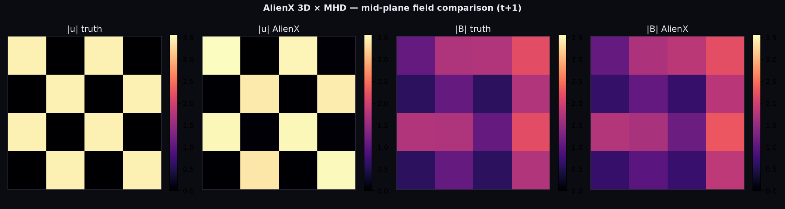
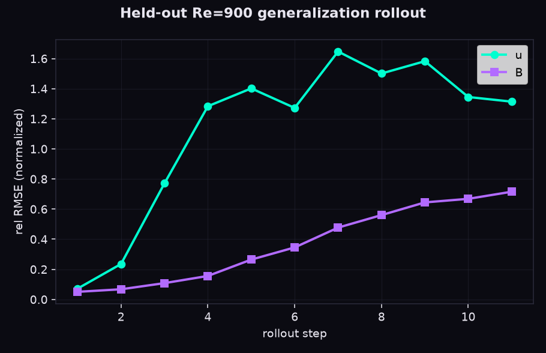
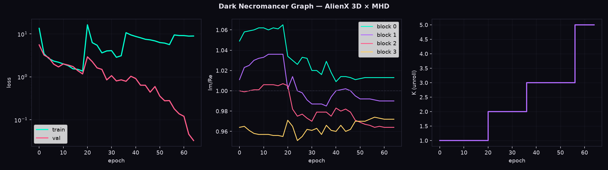

# AlienX MHD · Signal Lab

This is the live grant-facing exhibit for the AlienX 3D MHD release. It is not a mock dashboard: the plots shown in the Space are real artifacts from the recorded AlienX run.

## What is demonstrated

The Space lets a visitor switch between the field slice, held-out rollout, and invariant diagnostic, then scrub the rollout-step control. The evidence is tied to the six-gate protocol and the recorded hard-regime evaluation.







## Architecture

AlienX has a reusable geometric substrate and a physics-specific outer shell.

- **Substrate:** SO(3)-equivariant local frame, relevance-gated complex QSA, frame-relative phase modulation, regime conditioning, residual updates, and conservation-aware objectives.
- **MHD shell:** coupled velocity/magnetic state variables, Re/Rm conditioning, spectral MHD targets, divergence constraints, and MHD diagnostics.

The shell changes what the operator reads and predicts; it does not replace the AlienX geometric core.

## Hard-regime protocol

The recorded protocol uses a 32³ field, seeded multi-regime generation, five-epoch warmup, K=1→2→3→5→8 unroll curriculum, and held-out regimes `(3000,3000)`, `(3000,600)`, and `(600,3000)`. The gate suite covers frame equivariance, dealiasing, solver physics, reshape integrity, overfit convergence, and paired-rotation gradients.

The repository contains the exact run metadata, gate results, training logs, held-out diagnostics, rollout arrays, plots, source, checkpoint artifacts, and reproducibility paper.

## Reproduce and download

Download the full package from [ElBalor/AlienX-3D-MHD](https://huggingface.co/ElBalor/AlienX-3D-MHD). Run:

```bash
python -u source/AlienX-mhd.py
```

The Space is a static evidence viewer; the linked model repository is the executable release.
