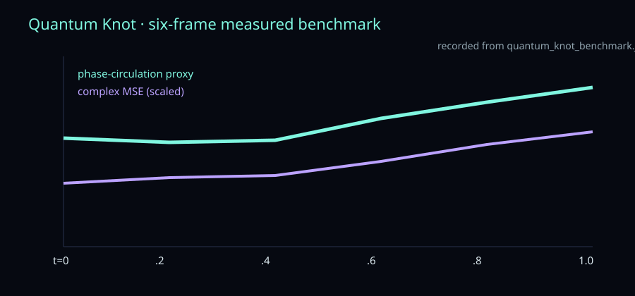

# AlienX Quantum Knot · Signal Lab

This is the live grant-facing exhibit for AlienX Quantum Knot v2. It exposes the actual measured temporal benchmark rather than a generic animation.

## What is demonstrated

The Space shows six deterministic frames from `t=0` to `t=1`, a perturbation control, frame-wise complex reconstruction error, prediction delta, and the phase-circulation proxy. The same fixed specimen/noise basis is used across the sequence, so the temporal control represents a controlled field response.



## Architecture

- **Substrate:** SO(3) local frame from local-neighbor covariance, relevance-gated complex QSA, geometric phase modulation, Hermitian complex interaction, coherent neighbor superposition, and residual updates.
- **Quantum Knot shell:** trefoil coordinates, density and phase channels, perturbation strength, normalized time, complex-density target, and vortex diagnostics.

## Measured benchmark

The 30-epoch, 4,096-particle run reduced loss from `1.1110` to `0.1044`. The benchmark includes perturbation sweep, phase-input ablation, six-frame temporal sequence, prediction deltas, phase-circulation proxy, and deterministic-inference verification. The complete JSON is in the linked model repository.

## Reproduce and download

Download the source, checkpoint, paper, and benchmark from [ElBalor/AlienX-Quantum-Knot](https://huggingface.co/ElBalor/AlienX-Quantum-Knot). Run:

```bash
python -u AlienX-Qknot.py
python -u benchmark_quantum_knot.py
```

The Space is a browser evidence viewer; it does not replace the trained checkpoint with a mock model.
