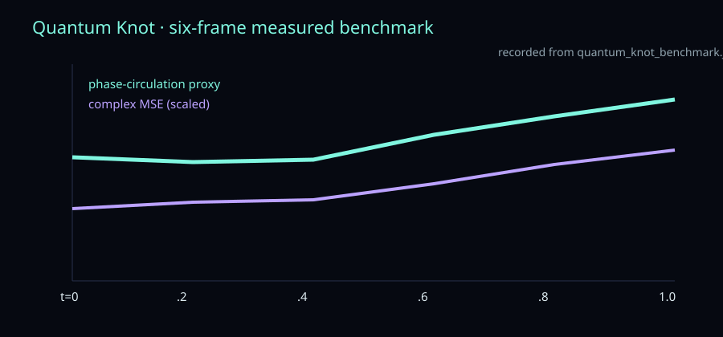

# AlienX Quantum Knot v2

## What this release is

AlienX Quantum Knot is a reproducible geometric neural-operator experiment for a perturbed trefoil vortex field. It is not a generic image model and it is not a conventional black-box sequence predictor. The experiment tests whether the AlienX substrate can preserve local geometric structure, complex phase coupling, and a controlled temporal response when the knot field is perturbed.

## Architecture

The reusable AlienX substrate contains:

1. an SO(3)-aware local frame built from coordinates and local-neighbor covariance;
2. relevance-gated local QSA over frame-relative displacements;
3. geometric phase modulation and complex Hermitian interactions;
4. coherent neighbor superposition with residual updates; and
5. normalized complex-field objectives.

The Quantum Knot outer shell supplies the trefoil coordinates, density and phase channels, perturbation strength, normalized time, complex-density target, and vortex diagnostics. The inner operator is unchanged; the outer shell maps the substrate to this physical field.

## Training and measured run

- 30 epochs
- 4,096 particles
- 32³ field convention
- perturbation sampled during training
- six deterministic evaluation frames from `t=0` to `t=1`
- loss: `1.1110 → 0.1044`
- final-frame complex reconstruction MSE: approximately `0.0504`
- phase-circulation proxy: approximately `0.0895`

The benchmark also includes a phase-input ablation, perturbation sweep, prediction deltas, and deterministic-inference check. These are recorded in `quantum_knot_benchmark.json`.

## Reproduce

```bash
python -u AlienX-Qknot.py
python -u benchmark_quantum_knot.py
```

For a non-interactive run set `ALIENX_KNOT_NO_LAUNCH=1`. The checkpoint is `alienx_quantum_knot_checkpoint.pt`.

## Files

- `AlienX-Qknot.py` — canonical training and inference source
- `alienx_quantum_knot_checkpoint.pt` — trained checkpoint
- `benchmark_quantum_knot.py` — reproducible benchmark
- `quantum_knot_benchmark.json` — measured benchmark output
- `AlienX_Quantum_Knot_Paper.docx` — full reproducibility paper
- `AlienX-Quantum-Knot-v2-release.zip` — compact release archive

## Complete benchmark evidence

Every recorded metric is duplicated in `metrics/quantum_knot_benchmark.json`, and the temporal graph is in `figures/temporal_benchmark.svg`.

| benchmark | included measurements |
|---|---|
| perturbation sweep | complex MSE, amplitude RMSE, phase alignment, and mean amplitude for strengths 0, .25, .5, .75, 1 |
| phase-input ablation | complex MSE, amplitude RMSE, phase alignment, and mean amplitude with phase channels removed |
| temporal sequence | six frames from t=0 to t=1, frame-wise complex MSE, prediction delta, and phase-circulation proxy |
| reproducibility | fixed specimen/noise basis and deterministic inference check |



## Scope

This release demonstrates perturbation-conditioned temporal complex-field response and active phase coupling. A solver-backed claim of physical reconnection requires independent temporal solver ground truth; the benchmark keeps that distinction explicit while exposing the complete reproducible experiment.

From the Grimoire of Elbàlor, the Digital Necromancer.
